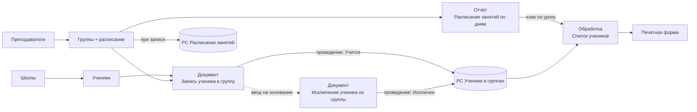

# Образовательный центр «Умняшки»


Конфигурация на платформе **1С:Предприятие 8.3** для учёта работы детского образовательного центра: ученики и их представители, преподаватели, учебные группы, недельное расписание занятий, запись и исключение учеников из групп, журнал занятия с печатной формой.

Проект выполнен как экзаменационная работа и входит в портфолио.

---

## Возможности

- **Справочники**: школы, ученики (с контактами представителя), преподаватели, группы с недельным расписанием.
- **Расписание без накладок**: урок длится 1 час, время начала с 10:00 до 19:00 с шагом 30 минут. При записи группы проверяется, что её уроки в один день не пересекаются и что преподаватель не занят в это время в другой группе.
- **Запись и исключение учеников** документами. Статус ученика в группе («Учится» / «Исключен») хранится в регистре сведений.
- **Отчёт «Расписание занятий по дням»**: недельная сетка (дни × время) по выбранному преподавателю или группе. Уроки выделены цветом, по клику на урок открывается список учеников группы.
- **Журнал занятия** (обработка «Список учеников»): отметка присутствия и оценки за домашнее задание, самостоятельную работу и урок (0–100), печать ведомости.
- **Карточка ученика** показывает группы, в которых он сейчас учится, ссылками на эти группы.
- **Формы документов** с цветным статусом (Новый / Записан / Проведен / На удаление) и своими кнопками проведения и пометки удаления.

## Требования

| Параметр | Значение |
|---|---|
| Платформа | 1С:Предприятие 8.3.27 или новее |
| Режим совместимости | `Version8_3_27` |
| Режим запуска | Управляемое приложение |
| Интерфейс | Такси |
| Блокировки данных | Управляемые |
| Вариант базы | Файловый (`1Cv8.1CD`) |

## Быстрый старт

1. Клонируйте репозиторий:

   ```bash
   git clone https://github.com/sugrinovich/1-.git
   ```

2. Откройте стартовое окно 1С:Предприятия и нажмите **Добавить → Добавление в список существующей информационной базы**.
3. Выберите тип расположения **«На данном компьютере»** и укажите папку с файлом `1Cv8.1CD`.
4. Запустите базу в режиме **1С:Предприятие** (работа пользователя) или **Конфигуратор** (просмотр и правка конфигурации).

Пользователи в базе не заведены, поэтому вход выполняется без авторизации.

## Как пользоваться



1. Заполните **Школы**, затем **Преподавателей** и **Учеников**.
2. Создайте **Группу**: укажите преподавателя и строки расписания (день недели и время начала).
3. Оформите и проведите документ **«Запись ученика в группу»**.
4. Откройте отчёт **«Расписание занятий по дням»**, выберите преподавателя или группу и нажмите **Сформировать**.
5. Кликните по уроку в сетке: откроется **«Список учеников»** группы. Отметьте присутствие, выставьте оценки и нажмите **Печать**.
6. Чтобы исключить ученика, введите на основании записи документ **«Исключение ученика из группы»**, укажите причину и проведите его.

## Структура конфигурации

Объекты разложены по четырём подсистемам: **Справочники**, **Документы**, **Регистры сведений**, **Обработки**.

### Справочники

| Объект | Реквизиты | Особенности |
|---|---|---|
| `Школы` | Адрес | Адрес обязателен и уникален: при записи проверяется, нет ли школы с таким же адресом |
| `Ученики` | Фамилия, Имя, Отчество, Школа, Телефон, Email, Представитель, ТелефонПредставителя | Наименование собирается из ФИО. Нельзя выбрать школу, помеченную на удаление. На форме выводятся текущие группы ученика |
| `Преподаватели` | Фамилия, Имя, Отчество, Телефон, Email | Наименование собирается из ФИО. Пустой Email заменяется на «нет» |
| `Группы` | Преподаватель; табличная часть **Расписание** (ДеньНедели, ВремяНачала) | Проверка накладок в расписании и занятости преподавателя. При записи расписание копируется в регистр `РасписаниеЗанятий` |

### Документы

| Объект | Реквизиты | Проведение |
|---|---|---|
| `ЗаписьУченикаВГруппу` | Ученик; табличная часть **Группы** | Записывает в `УченикиВГруппах` строку по каждой группе со статусом «Учится» |
| `ИсключениеУченикаИзГруппы` | Ученик, ДокументОснование, ПричинаИсключения; табличная часть **Группы** | Вводится на основании записи (ученик и группы заполняются автоматически). Переводит указанные группы в движениях документа-основания в статус «Исключен» |

### Регистры сведений

| Объект | Режим записи | Измерения | Ресурсы |
|---|---|---|---|
| `РасписаниеЗанятий` | Независимый, непериодический | Группа, Преподаватель, IDУрока | ДеньНедели, ВремяНачала |
| `УченикиВГруппах` | Подчинение регистратору, непериодический | Ученик, Группа | СтатусУченика |

### Перечисления

| Объект | Значения |
|---|---|
| `ДниНедели` | Понедельник … Воскресенье |
| `ВремяНачалаУроков` | 10:00, 10:30, … 19:00 (19 значений с шагом 30 минут) |
| `СтатусУченикаВГруппе` | Учится, Исключен |

### Отчёты и обработки

| Объект | Назначение |
|---|---|
| Отчёт `РасписаниеЗанятийПоДням` | Сетка расписания на неделю по преподавателю или группе. Расшифровка урока открывает обработку «Список учеников» |
| Обработка `СписокУчеников` | Журнал занятия: ученики группы со статусом «Учится», присутствие, оценки ДЗ / СР / Урок. Открывается только из отчёта. Форма `ФормаПечати` показывает табличный документ по макету `Макет` |

## Проверки и бизнес-правила

- Обязательные поля проверяются в `ОбработкаПроверкиЗаполнения`, все ошибки выводятся одним сообщением.
- Уроки одной группы в один день должны начинаться не ближе чем через 60 минут друг от друга.
- Преподаватель не может вести две группы, если их уроки в один день начинаются с разницей меньше 60 минут.
- Нельзя выбрать преподавателя, школу или ученика, помеченных на удаление.
- Проведённый документ нельзя пометить на удаление.
- Оценки в журнале должны быть от 0 до 100, отсутствующему ученику оценки ставить нельзя.

## Состав репозитория

| Путь | Что это |
|---|---|
| `1Cv8.1CD` | Файловая информационная база: конфигурация и данные |
| `1Cv8Log/` | Журнал регистрации |
| `1Cv8snc.1CD`, `*.cfl`, `1Cv8JobScheduler/` | Служебные файлы платформы |

### Как получить исходники в XML

Конфигурация хранится внутри `1Cv8.1CD`, поэтому код модулей на GitHub не виден. Чтобы выгрузить её в XML и `.bsl`-файлы, откройте базу в Конфигураторе и выберите **Конфигурация → Выгрузить конфигурацию в файлы…** или выполните из командной строки:

```bash
1cv8 DESIGNER /F "<путь к папке с базой>" /DumpConfigToFiles "<папка для выгрузки>"
```

## Автор

Сергей Угринович — [@sugrinovich](https://github.com/sugrinovich)
